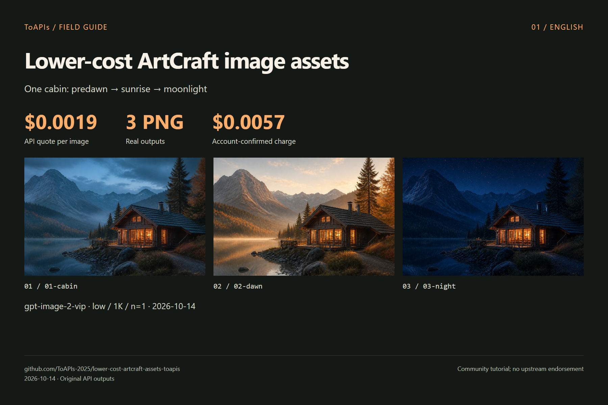

# Lower-cost ArtCraft image assets


<!-- TOAPIS-MODEL-COST-UPDATE-20261016 -->
## Tested model types, presets and costs

Updated October 16, 2026. These are tested historical presets/prices; this addition does not relabel the original batch below.

| Model (API ID) | Type | Tested preset | Unit quote | Confirmed unit charge | Count |
|---|---|---|---:|---:|---:|
| gpt-image-2(VIP) (`gpt-image-2-vip`) | Image | low / 1K / n=1 | $0.0019/image | $0.0019 | 3 |

Confirmed original image/video example subtotal: **$0.0057**.

Independent image API assets validated; canvas import and native provider integration remain unvalidated.

gpt-image-2(VIP), **from $0.0019/image**; the tested low/1K preset here is **$0.0019/image**. Different models, qualities and resolutions do not imply equivalent results.
<!-- /TOAPIS-MODEL-COST-UPDATE-20261016 -->


[中文](README_zh-CN.md)


ToAPIs `gpt-image-2-vip / low / 1K / n=1` for ArtCraft workflows. 3 image-2(vip) images: **$0.0057 actually charged**.


External ToAPIs asset script validates generation and reference edits. PNGs and parameter manifests are ready for import; ArtCraft canvas import and native providers remain untested.


> Community tutorial; no upstream endorsement. “Lower-cost” describes this API tier, not total software or all-model costs.


## Demo





| Case | Original image | Output pixels |

|---|---|---|

| 01-cabin | [PNG](assets/01-cabin.png) | 1536 × 864 |

| 02-dawn | [PNG](assets/02-dawn.png) | 1536 × 864 |

| 03-night | [PNG](assets/03-night.png) | 1536 × 864 |


## Model price and this demo’s cost


<!-- TOAPIS-IMAGE-SAMPLES-20261017 -->
## Same prompt: 8 image models and example costs

Tested **2026-10-17**: the same text-to-image prompt, one output per example, sorted by example amount from low to high. **gpt-image-2(VIP) starts at $0.0019/image; low/1K here is $0.0019/image.**

Each row identifies a task settlement receipt or an account billing log. Unknown-phase logs are not final net settlements; model/time-window candidates are not confirmed task matches. Catalog rates are historical quotes, not locked prices. gpt-image-2.5-flare-vip is token-metered: **$0.005272 is this image's settled charge**, not a fixed image rate. It is a different API ID from gpt-image-2.5-flare. Qwen has no returned key quote; only its example log amount is shown.

The prompt is shared, but quality defaults and output dimensions differ. Request presets and actual pixels are listed separately. Seedream Pro requested 1K with quality omitted (medium quoted), and returned 2048×2048. These are independent ToAPIs API asset tests; they do not extend any project's native-provider, UI, import or video validation, and are not added to the historical project subtotal below.

| Model / API ID | Request preset → actual pixels | Catalog rate (2026-10-17) | Example amount USD ↑ | Cost evidence | Real output |
|---|---|---:|---:|---|---|
| gpt-image-2(VIP)<br><code>gpt-image-2-vip</code> | 1K / low → 1024×1024 | $0.0019/image | **$0.0019** | Log: model/time candidate; phase unknown | <a href="https://raw.githubusercontent.com/ToAPIs-2025/toapis-quickstart/main/tutorials/image-model-samples-2026-10-17/images/gpt-image-2-vip.png"></a> |
| gpt-image-2.5-flare-vip | 1024x1024 / low → 1024×1024 | Token-based; key quote unavailable | **$0.005272** | Task receipt: settled | <a href="https://raw.githubusercontent.com/ToAPIs-2025/toapis-quickstart/main/tutorials/image-model-samples-2026-10-17/images/gpt-image-2.5-flare-vip.png"></a> |
| nano_banana | 1K / default → 1024×1024 | $0.012/image | **$0.012** | Log: model/time candidate; phase unknown | <a href="https://raw.githubusercontent.com/ToAPIs-2025/toapis-quickstart/main/tutorials/image-model-samples-2026-10-17/images/nano_banana.png"></a> |
| gemini-nano-banana-2.1 | 1K / default → 1024×1024 | $0.015/image | **$0.015** | Log: model/time candidate; phase unknown | <a href="https://raw.githubusercontent.com/ToAPIs-2025/toapis-quickstart/main/tutorials/image-model-samples-2026-10-17/images/gemini-nano-banana-2.1.jpg"></a> |
| gpt-image-2 | 1K / default → 1280×1280 | $0.015/image | **$0.015** | Log: model/time candidate; phase unknown | <a href="https://raw.githubusercontent.com/ToAPIs-2025/toapis-quickstart/main/tutorials/image-model-samples-2026-10-17/images/gpt-image-2.png"></a> |
| qwen-image-3.0 | 1K / default → 1024×1024 | Key quote unavailable | **$0.021** | Log: model/time candidate; phase unknown | <a href="https://raw.githubusercontent.com/ToAPIs-2025/toapis-quickstart/main/tutorials/image-model-samples-2026-10-17/images/qwen-image-3.0.png"></a> |
| gpt-image-2.5-flare | 1K / high → 1024×1024 | $0.0225/image | **$0.0225** | Log: model/time candidate; phase unknown | <a href="https://raw.githubusercontent.com/ToAPIs-2025/toapis-quickstart/main/tutorials/image-model-samples-2026-10-17/images/gpt-image-2.5-flare.png"></a> |
| doubao-seedream-5-0-pro | 1K / default → 2048×2048 | $0.042857/image | **$0.042856** | Log: model/time candidate; phase unknown | <a href="https://raw.githubusercontent.com/ToAPIs-2025/toapis-quickstart/main/tutorials/image-model-samples-2026-10-17/images/doubao-seedream-5-0-pro.jpg"></a> |


[Shared prompt, originals and cost sources](https://github.com/ToAPIs-2025/toapis-quickstart/tree/main/tutorials/image-model-samples-2026-10-17/README.md) · [Pricing API](https://docs.toapis.com/docs/en/api-reference/account/pricing)

<!-- /TOAPIS-IMAGE-SAMPLES-20261017 -->

| Model | Configuration | API unit quote |

|---|---|---|

| `gpt-image-2-vip` | `low / 1K / n=1` | **$0.0019** |


3 image-2(vip) images: **$0.0057 actually charged**。


[API pricing snapshot](evidence/pricing.json) · [Cost record](evidence/costs.json) · [Original requests](evidence/runs.json)


Quote checked on 2026-10-14. Other tiers, resolutions, models, agents and machine costs are excluded.


[ToAPIs model landing page](https://go2v.toapis.com/1014_artcraft_lowercost_gh_en)


## Reproduce


Set `TOAPIS_API_KEY` privately in your local environment. Keep it out of source code and chats. Use `TOAPIS_BASE_URL=https://toapis.cn` or `https://toapis.com`.


```bash

# Inspect without paid calls

python scripts/run_demo.py

# Generate the original cases (charged; exact quote checked first)

python scripts/run_demo.py --live --output results

```


The generic script is an external asset runner. Original PPT Master CLI runs are separately identified in the evidence.


## API mapping


```text

Authorization: Bearer TOAPIS_API_KEY

POST /v1/uploads/images             # reference PNG -> HTTPS URL

POST /v1/images/generations         # model,prompt,size,resolution,quality,n,reference_images

GET  /v1/images/generations/{id}    # poll the SAME task

completed -> result.data[0].url -> download PNG without the API key

```


Generation POST is never automatically retried. Preserve .toapis-state or results/private-state to resume the same task. Reference editing is not masked inpainting. Masks, transparency, audio and cloud video were not tested.


## Upstream and licenses


[storytold/artcraft](https://github.com/storytold/artcraft) · [pinned `d4e4ac69`](https://github.com/storytold/artcraft/tree/d4e4ac69bbd93d237eaf5d0260bc6a5ff3a5e373)


[Third-party notices](THIRD_PARTY_NOTICES.md)

