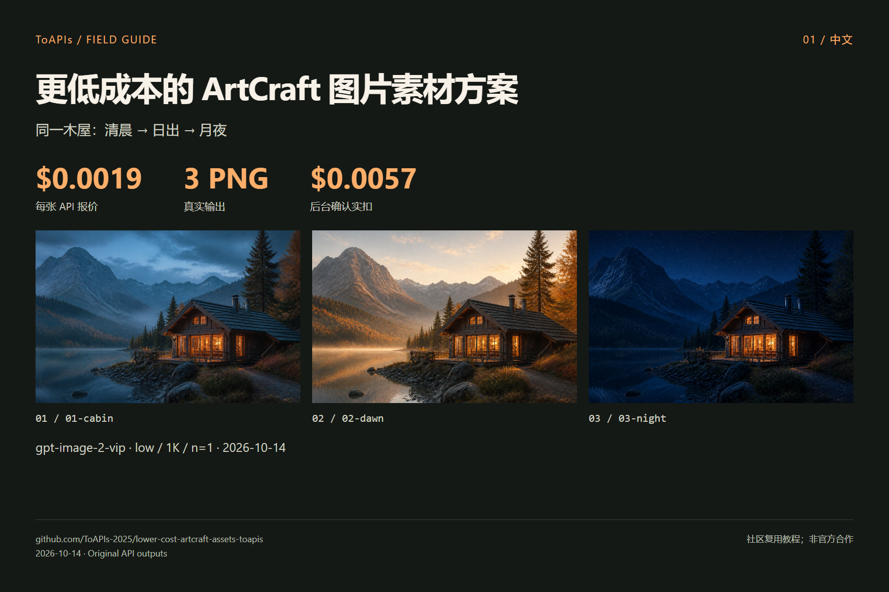

# 更低成本的 ArtCraft 图片素材方案

<!-- TOAPIS-MODEL-COST-UPDATE-20261016 -->
## 模型类型、测试档位与花费

更新：2026-10-16。下表为已验证案例的历史档位与价格；本段补充不改变下方原批次记录。

| 模型（API ID） | 类型 | 测试档位 | 单次报价 | 已确认单次消费 | 数量 |
|---|---|---|---:|---:|---:|
| gpt-image-2(VIP) (`gpt-image-2-vip`) | 图片 | low / 1K / n=1 | $0.0019/image | $0.0019 | 3 |

原图片/视频案例已核对消费小计：**$0.0057**。

独立图片API素材已验证；画布导入和原生Provider未验收。

gpt-image-2(VIP) **$0.0019/image 起**；本表 low/1K 实测档位为 **$0.0019/image**。不同模型、质量和分辨率不代表同质效果。
<!-- /TOAPIS-MODEL-COST-UPDATE-20261016 -->

[English](README.md)

以 ToAPIs `gpt-image-2-vip / low / 1K / n=1` 复用 ArtCraft 场景。3张 image-2(vip) 生图实扣 **$0.0057**。

独立 ToAPIs 素材脚本完成文生图与参考改图；提供 PNG 和参数清单供导入，ArtCraft 画布导入与原生 Provider 未验收。

> 社区教程；未获上游背书。“更低成本”描述本次 API 档位，不表示整个软件或全部模型总成本更低。

## 演示



| 案例 | 原图 | 输出像素 |
|---|---|---|
| 01-cabin | [PNG](assets/01-cabin.png) | 1536 × 864 |
| 02-dawn | [PNG](assets/02-dawn.png) | 1536 × 864 |
| 03-night | [PNG](assets/03-night.png) | 1536 × 864 |

## 对应模型价格与本次花费

| Model | 配置 | API 单张报价 |
|---|---|---|
| `gpt-image-2-vip` | `low / 1K / n=1` | **$0.0019** |

3张 image-2(vip) 生图实扣 **$0.0057**。

[API pricing snapshot](evidence/pricing.json) · [Cost record](evidence/costs.json) · [Original requests](evidence/runs.json)

报价核查于 2026-10-14；不含其他画质、分辨率、模型、Agent 或机器成本。

[ToAPIs 模型落地页](https://go2v.toapis.com/1014_artcraft_lowercost_gh_cn)

## 复现步骤

本机私有环境配置 `TOAPIS_API_KEY`，不要写进源码或聊天。`TOAPIS_BASE_URL=https://toapis.cn`（海外可用 `https://toapis.com`）。


```bash
# Inspect without paid calls
python scripts/run_demo.py
# Generate the original cases (charged; exact quote checked first)
python scripts/run_demo.py --live --output results
```

本通用脚本是独立 API 素材脚本；PPT Master 的原 CLI 实测记录单独标注在证据中。

## 接口映射

```text
Authorization: Bearer TOAPIS_API_KEY
POST /v1/uploads/images             # reference PNG -> HTTPS URL
POST /v1/images/generations         # model,prompt,size,resolution,quality,n,reference_images
GET  /v1/images/generations/{id}    # poll the SAME task
completed -> result.data[0].url -> download PNG without the API key
```

生成 POST 不自动重试；轮询超时保留 `.toapis-state` 或 results/private-state 的任务 ID，重新执行同一用例会继续查询。参考改图不等于 mask 局部重绘；本轮没有测试 mask、透明背景、音频或云端视频。

## 上游与许可证

[storytold/artcraft](https://github.com/storytold/artcraft) · [pinned `d4e4ac69`](https://github.com/storytold/artcraft/tree/d4e4ac69bbd93d237eaf5d0260bc6a5ff3a5e373)

[Third-party notices](THIRD_PARTY_NOTICES.md)
